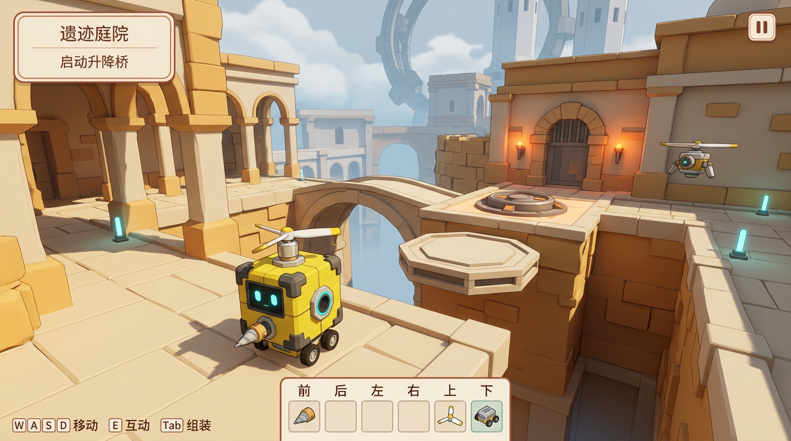
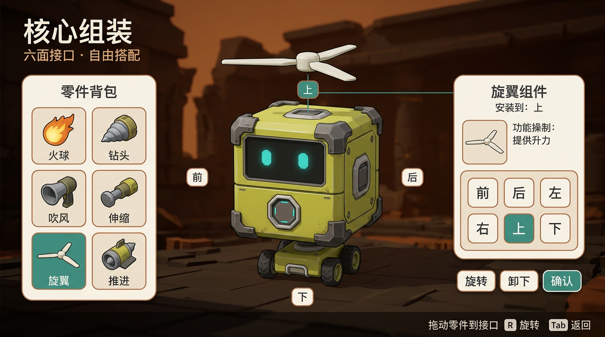
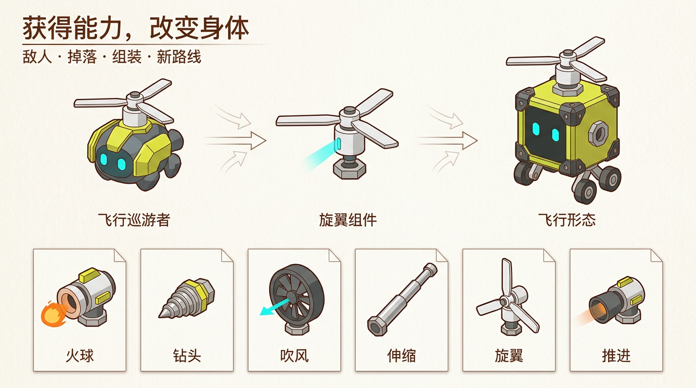
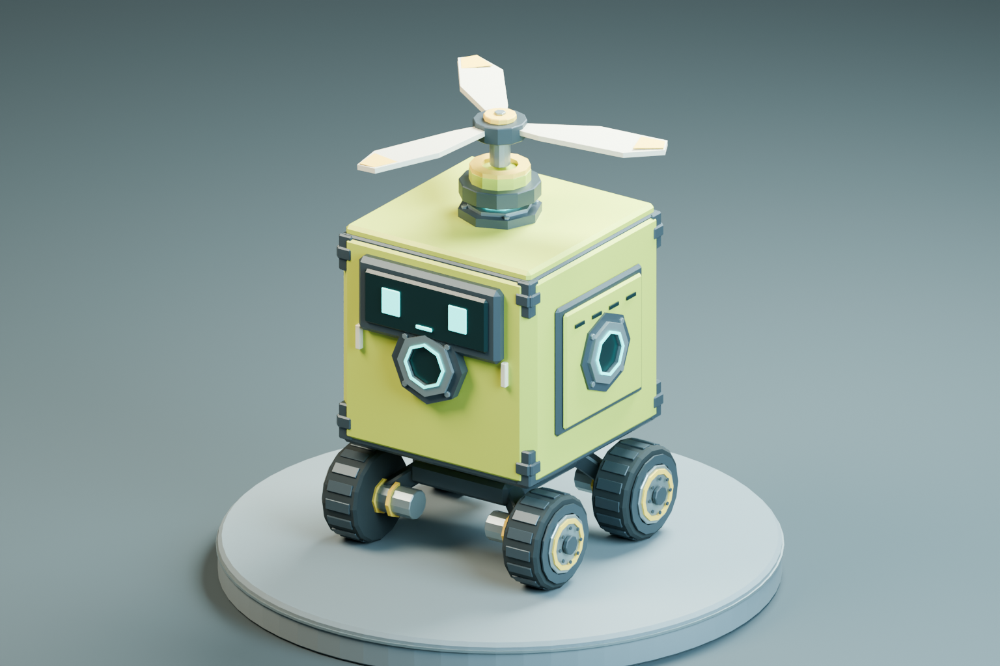

# 整体设计稿 v0.1：核心方块的机械旅行

> 历史稿：场景尺度、镜头与方向性组件规则已由 [v0.2 设计修订](../v0.2/DESIGN.md) 更新；相关冲突以 v0.2 为准。

- 日期：2026-10-24
- 状态：设计提案；不是已实现功能清单。本轮不修改游戏代码。
- 已确定方向：核心方块就是玩家、六面装配、模块化 Low Poly；参考《机器终末旅行》PV 的组装解谜与空间氛围。
- 长期目标：探索与战斗获得功能组件，组装到自身，改变能力与通行路线；解谜是能力的使用场景之一。
- 首期优先：连续解谜冒险的可玩垂直切片，先做好角色、组装、组件与关卡；不把完整战斗和装备经济一次塞入首期。
- 暂定工作名：核心漫游；正式命名另行确定。

## 1. 设计一句话

**我就是一个核心方块；我获得什么、装在哪里，决定我如何行动、与世界互动、进入哪些新区域。**

不是玩家驾驶战车，也不是人形角色换武器。轮足、旋翼、工具和推进器都是玩家身体的可替换部分。

### 三条不可偏离的原则

1. 核心身份：不同组合下仍一眼认出同一个方块主角。
2. 组合有意义：安装位置、朝向和功能搭配改变结果，不只改变外观或属性数值。
3. 能力来自世界：零件是可以看见、理解、拾取的实体，不主要依靠菜单凭空解锁。

### 长期循环

探索 → 发现障碍或机械生物 → 解谜／交战／寻找零件 → 拾取 → 安装与调整 → 新的行动能力 → 新路线与新的组件来源。

首期采用地面拾取和机关奖励；后续扩展“飞行小怪被击败 → 它的旋翼成为掉落物 → 玩家装上后能飞”。后者是用户明确的长期方向，不是此时承诺已经存在的机制。

## 2. 视觉设计稿

### 2.1 探索与 HUD

- 暖色遗迹、清晰平台路线、巨大机械遗构与冷色远景，衬托小核心。
- 正常探索只保留目标、交互提示、六面装备状态和暂停入口；不常驻大背包。
- 图中飞行巡游者属于后续生态示意，首期解谜区不强制加入战斗。

### 2.2 六面组装界面

- 左：背包；中：自身与接口；右：选中零件、作用方向、六面选择和操作。
- 六面选择固定为“前、后、左、右、上、下”；可旋转预览，也支持直接点接口。
- 图中的字体、方向小标签和个别功能文案是生成示意，正式 UI 以本设计稿的规则、文字和真实接口位置为准；不能把图片当可交互 UI 或精确坐标图。

### 2.3 组件与敌人生态

- 同一种旋翼设计贯穿小怪、掉落物和玩家装备。
- 图是轮廓、配色与复用关系设定，不代表已有六种零件模型或小怪资产。
- 火球、钻头、吹风、伸缩、旋翼、推进是首批功能族；轮足是单独的基础移动组件。

### 2.4 当前真实模型基准

已完成样件：`generated-assets/core-robot/core_robot.blend` / `core_robot.glb`。

以真实模型的六面接口、护角、表情屏、结构分件为基准，不将概念图中的造型变体直接替换已认可模型。样件约 13,488 三角面，是精细展示级基准；实机 LOD、材质批次和碰撞仍需优化。

## 3. 玩家与移动

### 3.1 核心

- 一个固定身份的立方体核心，六个接口，无可被误解为驾驶员的人形角色。
- 表情屏保留在正面上半部；前接口位于中央功能区，装备不能完全遮住双眼。
- 使用黄绿色外壳、深石墨结构、窄青色状态灯；部件展开时仍保留核心轮廓。
- 首期核心按约 1 米宽的资产尺度设计；最终操作尺度由实机校准，不按概念图透视测量。

### 3.2 控制方式

- 使用稳定的角色控制器承载主体，轮足提供地面行驶能力；轮子表现和机身倾斜独立于控制胶囊。
- 飞行由已装能力输入决定；保留重力、碰撞、落地与移动平台交互，而不是自由摄像机式飞行。
- 箱子、碎块、投射物等使用物理模拟，不强求核心身体全部自由刚体化。
- 不默认赠送能绕过组件谜题的大跳。脱下轮足后允许低速核心挪动，或通过组装恢复移动；该防软锁规则为本稿提案。
- 基础键位建议：WASD 移动、E 互动、Tab 组装、鼠标调整视角。能力显示自己的键位提示并允许改绑，不能要求玩家同时记住六套隐藏按键。

### 3.3 表现反馈

- 移动：轮子转动、轻微机身俯仰，停下有短暂机械缓冲。
- 激活：功能部位发光／转动／伸缩，作用方向与预览一致。
- 拾取：组件短暂悬浮展示，名称与能力图标出现，然后进入库存。
- 不用大段剧情打断教学；用表情、声效、环境和短提示表达。

## 4. 六面装配规则

### 4.1 首期规则（提案）

| 规则 | 定义 |
|---|---|
| 主接口 | 六面各一个；六面均可尝试安装兼容零件 |
| 初始配置 | 核心＋底部轮足，其它面空；不是无限工具起步 |
| 首期装配深度 | 每面一个直接安装模块；连接件与串联接口在后续扩展 |
| 朝向 | 面法线决定工作轴，绕工作轴按 90° 旋转；具体零件可声明兼容姿态 |
| 实例 | 每一枚零件只能属于背包、身体或世界中的一种状态 |
| 替换 | 旧件回到背包，新件占用接口；一次事务完成，失败不丢件 |
| 卸下 | 返回背包，不删除、不复制实例 |
| 合法性 | 校验连接规格、互相穿插、场景空间和功能兼容性，并给出失败原因 |
| 输入 | 相同能力可分组激活，也可单独改绑；分组不改变实际装配位置 |

每面一个模块是首期可控范围，不将其写死为长期上限。数据结构保留连接图的扩展空间，但先不实现无限枝杈。

### 4.2 组装交互

1. 在稳定落地、未受击的状态按 Tab 打开；首期单人解谜组装暂停模拟。
2. 拖动背包里的零件，或先选择零件再点击接口。
3. 看到半透明预览、作用轴、插槽占用和影响轮廓。
4. R 旋转；不合法时预览变色并说明冲突。
5. 确认后提交装备状态，同步模型、能力和碰撞；取消恢复原配置。
6. 返回探索后看到完整身体和可用动作提示。

战斗期需要独立评估组装是否允许、如何暂停及能否利用暂停躲避攻击；不直接照搬解谜期规则。

### 4.3 不能出现的假组合

- 安装在左面却仍沿世界固定前方向吹风。
- 图片安装了旋翼，但能力由与装备无关的全局开关提供。
- 多装推进器只增加装饰，或不设限制地无限加速。
- 轮足被卸下后仍像完整车辆一样行驶。
- 装备数量与库存数量不守恒；反复拾取同一掉落物复制零件。

## 5. 组件功能矩阵

| 功能族 | 首期解谜用途 | 后续扩展 | 轮廓与表现 |
|---|---|---|---|
| 轮足 | 行驶、转向、承载平台 | 不同移动底座 | 深灰短轮足，可与核心独立拆分 |
| 火球发射器 | 点燃火盆、触发热机关 | 机械生物战斗与环境联动 | 米白环形口、橙色火球，区别于推进尾焰 |
| 钻头 | 打开可碎岩层和封堵物 | 装甲破坏／采集 | 短金属锥、旋转螺纹 |
| 吹风机 | 推轻物、偏转火球、驱离浮游物 | 改变敌人位置与环境状态 | 圆形扇罩、青色方向线 |
| 伸缩棍 | 远程按压、推箱、够到按钮 | 更复杂的机械组合 | 分段直杆、清楚的伸出距离 |
| 螺旋桨 | 升空、跨过高差 | 飞行敌人掉落来源 | 米白三叶旋翼、转速反馈 |
| 火箭推进器 | 短时加速、跨间隙 | 高速机动、特化模块 | 深灰喷口、短橙色尾迹 |

### 组合示例

- 上置旋翼＋后置推进器：升空后横向穿过断桥。
- 吹风＋火球：改变火球路径，触发无法直接射到的火盆。
- 伸缩＋位置调整：核心停在安全侧，远程按桥对面的机关。
- 钻头＋移动底座：靠近可碎岩层，开启另一条通路。

同一种组件在不同朝向可能具有不同用途。首期只保证有测试覆盖的组合，不宣称任意叠加都有合理玩法。

### 功率与飞行限制

不首期引入稀有度、词条、掉率经济或过度数值面板。通过速度／推力上限和短时能力窗口防止绕过所有关卡；持续时间、恢复速度、核心承重等都列为待调参数，而非已知 PV 规则。

## 6. 世界、机关与首章流程

### 6.1 第一章：遗迹庭院

目标是一段约 10–15 分钟的连续体验，时间是设计目标，不是已测结果。

| 区段 | 玩家学会什么 | 使用内容 | 通过条件 |
|---|---|---|---|
| A 起始庭院 | 自己是方块、移动与拾取 | 轮足、第一枚零件、组装提示 | 零件已获得且正确装备 |
| B 碎石回廊 | 零件真的改变世界 | 钻头、可碎封堵 | 从新打开的通道通过 |
| C 热能机关 | 工具作用于目标 | 火球、火盆、升降桥 | 点燃目标，桥进入可通行状态 |
| D 高台支线 | 六面方向与配置选择 | 旋翼拾取、高差、落点 | 通过高度差并到安全落点 |
| E 断桥组合 | 组合比单功能更有用 | 旋翼＋推进、可选远程机关路线 | 至少两条经过验证的解法能到达出口 |
| F 出口检查点 | 结束与继续探索 | 门、检查点、冷白高塔远景 | 玩家核心到达，不允许碎块误触通关 |

首章至少包含一条可选探索支线，奖励功能零件或更短通路；不靠必须重复刷怪拖长体验。

### 6.2 机关规则

- 使用点燃、风力、冲击、按压等明确交互通道；机关根据收到的作用变化，不直接读取“玩家装了某件零件”自动完成。
- 平台状态明确：待机、激活、移动、就位；灯色与动画反馈一致。
- 可破坏对象标识清楚；装饰建筑不假装可钻。
- 移动平台承载玩家，速度和落点可预判；相机同时展示起点和目标。
- 可推出关卡的必需物体应能复位；关键零件不得永久丢入深渊导致软锁。

### 6.3 失败恢复

掉落深渊或核心损坏后回到最近检查点。解谜阶段保留已获得零件与合法装备；当前谜题中危险丢失的必需物体可重置。具体机关持久状态与检查点快照版本化，不能只记录角色位置。

## 7. 战斗与掉落：后续方向

### 7.1 首个验证对象：飞行巡游者

- 小怪身上的旋翼清楚可见；移动方式提前告诉玩家它的功能。
- 玩家击败后，旋翼成为真实世界拾取物；其模型、接口与玩家版本同源。
- 飞在深渊上方的掉落物必须转移到安全拾取点，或提供明确回收机制；不会奖励一个永远够不到的关键零件。
- 掉落有唯一实例标识，一次拾取只能成功一次，存档读回不能重复刷同一奖励。
- 扩展验收必须实际跑通“交战 → 掉落 → 拾取 → 装配 → 获得飞行 → 跨越原先无法通过的地形”，而不仅做掉落动画。

### 7.2 后续组件来源

按功能设计生物：飞行、吹风、钻掘、推进等。先使用固定、可预测的功能掉落，验证玩法再考虑随机性；暂不做大量只改数值的装备。

## 8. 美术、镜头与 UI 规范

### 8.1 风格

- 模块化 Low Poly，不采用可挖掘体素世界。
- 主角和零件精细硬表面；环境大色块、少纹理、少碎装饰。
- 可爱而可靠的机械物件，安静巨大遗迹；避免军事战车审美、脏写实废土和全屏金黄滤镜。
- 六面装配使用积木语法，但轮子、旋翼、钻头保留区别明显的轮廓。

### 8.2 配色（设计基准）

| 用途 | 色彩方向 | 初始色值参考 |
|---|---|---|
| 核心 | 暖黄绿 | `#B7C53B` |
| 结构 | 深石墨 | `#263339` |
| 金属 | 低反射青灰 | `#859795` |
| 功能面 | 暖米白 | `#E7DFC9` |
| 遗迹 | 赭红／铜棕 | `#A96145` |
| 地面 | 浅砂石 | `#D9C3A0` |
| 远景 | 青灰雾 | `#7B969C` |
| 交互 | 青绿色 | `#58CFC3` |
| 已激活机关 | 橙金 | `#EDAD59` |

色值不是全局滤镜。环境、核心和状态指示形成对比；危险同时用形状、动作、声音表示，不能只靠颜色。

### 8.3 镜头

探索使用较高三分之四视角，初始俯角约 30°–35°；精确参数实机调整。保持路线、落点和核心可见，避免自由相机把核心藏入巨柱。组装界面单独使用预览镜头，可绕核心旋转，不移动游戏角色。

### 8.4 UI

- 探索：章节／短目标、六面状态、能力键位、附近交互提示。
- 组装：库存卡片、身体预览、接口状态、模块说明、旋转／卸下／确认／取消。
- 拾取：短名称、轮廓图标、能力用途；第一次拾取提供简短提示。
- 空槽显示“空”，不可用状态给原因；确认是唯一提交按钮，不用图片中的假按钮顶替真实控件。
- 窗口适配至少覆盖 1280×720 与 1920×1080，关键按钮不裁切，键鼠流程不依赖拖拽这一种操作。
- 首期不常驻地图、复杂装备评分、商城、稀有度框或大量数字。

## 9. 资产生产与复用

- 一枚组件定义＋一份原始模型，分别用于世界拾取、小怪装备、玩家装备和 UI 缩略图；使用不同宿主，不复制多套不一致资产。
- 统一接口尺度、法线、旋转轴和基准位置，导出后在 Godot 检验，不能仅凭 Blender 轴向猜测。
- 功能动画独立于根节点：旋翼转子、轮子、伸缩段都要可独立驱动。
- 灯光、展示台、摄像机不能进入正式角色 GLB。
- 近景模型、LOD 和简化碰撞分开制作；小螺钉与胎纹不生成独立碰撞。
- 当前样件多材质拆分可能增加渲染批次；正式运行时优化材质槽、共享材质与小怪 LOD，不只看总面数。

## 10. 重构落地边界（拟定）

保留 Godot 4.7.2、Blender MCP、现有验收 Skill 与运行工具。新冒险主干与旧车辆沙盒并存过渡；不先删除整个旧项目。

| 模块 | 重构职责 | 当前边界 |
|---|---|---|
| 玩家 | 核心移动、落地、能力与表现 | 用新控制主干替代自由刚体战车作为主玩家 |
| 装配 | 六面槽、实例所有权、合法性、预览与提交 | 不让 UI 直接改底层网格和能力开关 |
| 组件 | 定义、实例、功能、连接点 | 不把敌人掉落写死在关卡脚本里 |
| 世界 | 拾取、机关、平台、出口、检查点 | 改成连续关卡，不再切建造／模拟两张地图 |
| 存档 | 版本、库存、装备、检查点和机关 | 与旧机器 JSON 存档隔离，不静默覆盖 |
| 美术 | K-01 实机化、组件模型、模块化环境 | 概念图不直接当成正式游戏资产 |
| 验收 | 新玩法断言、视频、截图、报错探针 | 保留旧回归直到新主干验收通过 |

当前已有源码入口包括 `scripts/core/block_db.gd`、`machine.gd`、`machine_assembler.gd`、`game_state.gd`、`save_manager.gd`、`scripts/ui/`、`scripts/camera/` 与 `scripts/world/`。这里只划定设计职责，不在本轮修改或重写这些文件。

## 11. 实施阶段与交付门槛

| 阶段 | 交付物 | 必须验收 |
|---|---|---|
| A 视觉与移动基准 | K-01、遗迹庭院灰盒＋美术小块、探索镜头 | 核心轮廓、灯光、台阶与平台移动稳定；实机截图对照样件 |
| B 六面装配闭环 | 六槽、背包、拾取、预览、替换、卸下、取消 | 数量守恒、方向正确、冲突反馈、读回一致 |
| C 解谜垂直切片 | 钻头、火球、旋翼和连续路线 | 通过真实操作完成整段；失败后可恢复；不是靠测试直接设成通关 |
| D 首章完整组合 | 吹风、伸缩、推进、分支通路、检查点 | 至少两种组合解法、错误方向不触发、关键物不丢失 |
| E 战斗掉落试验 | 一种飞行怪与旋翼掉落链 | 完整“击败获得能力并开启新路线”流程与保存恢复 |

### 所有阶段共同要求

- 本轮完整 Godot 日志无未解释错误，警告单独处理；保留真实失败证据。
- 自动检查除正例外必须有反例：错误接口、已占用实例、无能力尝试机关、重复拾取、无关刚体进入终点等应失败。
- 录制真实渲染视频，实际读取截图与视频抽帧；不能把 AI 概念图当作验收证据。
- 性能目标为本机目标场景 1080p 下稳定 60 FPS，需实测；不是凭现有 RTX 5060 或模型面数宣称达标。

## 12. 待实机验证与决策

本稿建议先按上述默认规则制作垂直切片，再用证据调整以下参数：

- 组装暂停与战斗风险如何兼容。
- 飞行持续时间、推进速度与关卡尺度。
- 同类能力分组、输入数量和接口遮挡。
- 同一模块是否允许在任意面工作，哪些姿态应限制。
- 连接件和多级组合什么时候开放，不先扩成无限装配。
- 核心表情屏在侧装／前装大组件时的可见性。
- 以 PV 和公开 Demo 作玩法参考，但不直接复用其配乐、商标或未授权模型。

## 13. 本轮交付记录

三张视觉稿均为生成的概念设计，不是实机；模型几何与实际数据以已验证的 K-01 源文件为准。为修正首张组装图中的多余百分比和重复方向提示，本轮生成了四张图，交付三张整理后的稿件；重复原生成稿已在提交前清理，保留本目录三张最终设计图。未读取到计费数据，不虚构图片额度或会话费用。

- `01-exploration.png`：暖色遗迹探索与最小 HUD。
- `02-assembly.png`：六面接口组装界面。
- `03-components.png`：敌人、掉落、装备的组件复用设定。
- `DESIGN.md`：本整体设计稿。

后续先做 A 阶段的小成品，证明既像又好操控，再推进装配和整段关卡；不继续沿旧战争机器沙盒追加主玩法。
