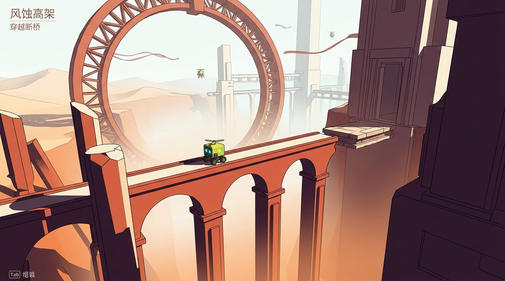
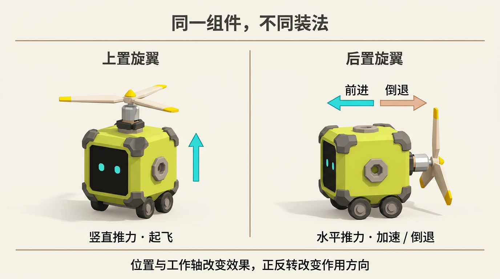

# 整体设计稿 v0.2：宏伟遗迹与方向性组件

- 日期：2026-10-24。
- 状态：设计修订，不是已实现功能。本轮只新增设计稿与图片，不修改游戏代码。
- 来源：用户提供的巨型高架／机械圆环截图，以及《风之旅人》的大尺度遗迹与旅途感参考。
- 本版覆盖 v0.1 的场景尺度、固定探索镜头、旋翼作用和组合示例；库存守恒、六面接口、首期解谜与后期战斗掉落方向继续保留。
- 基准文件：[整体设计稿 v0.1](../v0.1/DESIGN.md)。真实角色仍采用 `generated-assets/core-robot/core_robot.blend`，不因概念图变体重做已认可的核心。

## 1. 用户已明确的方向

1. 场景更贴近《风之旅人》的宏伟感，不是近景小庭院或微缩玩具场景。
2. 同一零件在不同面安装，会因位置和姿态产生不同功能。
3. 旋翼装在上方能起飞；装在后方能加速或倒退。
4. 核心方块本身就是玩家，六面都能接组件；未来组件来自路上拾取和敌人掉落。

## 2. 新场景基准：人小、结构大、距离深

图片为艺术目标概念稿，不是已实现实机截图；采用原创机械遗迹，不复用参考作品的角色、关卡或素材。

### 2.1 宏伟不是增加一座背景建筑

玩家脚下的路本身就是巨型设施的一小部分：几百米高的拱架顶端、贯穿巨构的维修栈道、悬挂在巨门边的升降平台。远景巨环不是庭院里的一件装饰，而是比玩家可走区域更大的结构。

画面层次：

| 层次 | 内容 | 目的 |
|---|---|---|
| 前景 | 裁出画面的巨柱、厚墙、残缺拱券 | 暗色构图框架与尺度压迫 |
| 操作中景 | 核心、可走高架、落点、移动平台与少量机关 | 保证实际操作可读性 |
| 远景 | 镂空巨环、米白高塔、跨层连廊 | 明确目的地和巨构轮廓 |
| 极远景 | 风沙、云雾深渊、淡色天际与沙海起伏 | 纵深、孤独与未知旅程 |

不以满屏小砖、螺钉和随机废墟堆出复杂度。先建立巨大的连续轮廓、负空间和光雾分层，再补必要细节。

### 2.2 初始尺度与美术约束

以下为美术原型建议，不是对原作尺寸的测量：

- 核心约 1 米宽；主要支撑高度可从 30–80 米试起，背景巨环直径从 80–150 米试起。
- 大尺度镜头中核心可占屏幕高度约 2%–4%；它是参照物，不是满屏角色展示。
- 不把所有实际跳跃、飞行距离也扩大同样倍数：可操作路线仍按控制手感标定，宏伟主要由支撑、远景和高度差形成。
- 远景采用低复杂度轮廓、实例化模块和分层雾，避免因为画面宏大就把全部几何、碰撞都做成巨大高精度场景。
- 暖赭红近景、紫褐暗部、米白受光面；距离越远对比越低、越接近雾色。青色只保留给核心、交互与少量功能提示。
- 不使用强全屏橙色滤镜；远景的淡青灰／米白仍与近景暖色分离。

### 2.3 镜头节奏：眺望、操作、组装

不再锁死全部区域为 v0.1 的 30°–35° 近景斜俯视。

- **眺望镜头**：进入巨构区域时平滑拉远，展示纵深、完整高架和目的地；不强制长时间剥夺操作。
- **操作镜头**：来到机关、窄桥、落点或拾取物附近时拉近，核心建议占画面高度约 5%–8%；根据实机可读性调整，不让玩家找不到自己。
- **组装镜头**：独立放大身体、接口和工作轴，背景弱化；不改变世界中的角色位置。
- 相机防穿墙，关键落点与核心不能同时被巨柱挡住；转角处要显示即将进入的通路。
- 用路径亮暗、结构开口和远景地标引导，不给每个角落贴箭头或浮动图标。

### 2.4 UI 随镜头克制变化

眺望时收起大面板，短目标和 Tab 提示足够；接近操作点后再显示交互与必要能力提示。六面状态栏可以淡出或按需展开，不用固定巨大底栏压缩宏大画面。

## 3. 基础机制：功能由姿态产生，不由装备名字写死

### 最新确认：位置绑定按键，朝向独立配置

用户已确认以下控制取代按意图自动分配动力、工具切换及固定面法线工作轴的旧提案。六面名称固定在核心本地坐标，视角变化不会重新映射按键。

| 核心安装面 | 直接触发键 |
|---|---|
| 左 | Q 或 ←，等价别名 |
| 右 | E 或 →，等价别名 |
| 上 | ↑ |
| 下 | ↓ |
| 前 | Z |
| 后 | X |

- 按键直接触发该面道具，不切换选中工具；不同面的道具可同时使用。
- 同一面的两个别名键映射一个动作；同时按下不重复发射、不叠加推力。持续道具在最后一个别名键松开时停止。
- 安装面决定触发键与作用点；安装朝向独立选择前、后、左、右、上、下，决定实际工作轴。
- 例如左面道具无论向前发射、向后发射还是向上／向下发射，都由 Q 或 ← 触发；反向安装不是另绑一个触发键。
- 组装时先选安装面，再选工作朝向，显示作用预览并检查几何冲突。不能把“装在左面”自动解释为“向左工作”。
- 旋翼支持按安装朝向产生不同方向的动力；是否另外支持运行时正反转属于未确认功能，不默认增加一套反转按键。
- E 已用于右面道具，原 E 互动需移走；F 互动、WASD 基础移动与 Tab 组装保留为建议，不视为本次用户确认。

图用于说明顶置与后置的差别，具体中文、箭头与模型方向以实际工作轴和下表为准。

### 3.1 旋翼不是“飞行开关”

旋翼的基础作用是沿自身转轴产生可控推力。安装面决定作用点与触发键，独立设置的安装朝向决定这根轴在核心坐标中的方向。下表只举常见装法，不限制某一面只能朝某一方向工作；运行时正反转暂不作为确认需求。

| 安装位置／配置 | 工作轴 | 作用结果 | 控制与提示 |
|---|---|---|---|
| 顶面旋翼 | 竖直 | 升空、抵消重力；反向输出可增加向下作用 | 上升／下降；停转后依重力和惯性运动 |
| 后面旋翼 | 前后水平 | 前向加速或反向倒退 | 前进／倒退；不是另一种专用推进器 |
| 左／右面旋翼 | 左右水平 | 侧向移动或侧向修正 | 左移／右移；需要控制与空间限制 |
| 顶面＋后面两枚旋翼 | 两根独立轴 | 一枚升空，一枚负责横向移动 | 玩家理解多轴组合，不必指定只有火箭才能平飞 |

上表前两项是用户明确要求；侧面作用和双旋翼组合是按同一基础规则延伸的本稿提案，需实机验证。

### 3.2 统一规则

- 每个组件定义自己的本地工作轴、作用点和可支持的输入范围。
- 装配变换把本地工作轴变为核心／世界中的实际轴；核心转向后，组件效果也随核心改变，不锁在世界坐标。
- 按安装面显示固定触发键，按安装朝向显示实际作用；例如“左面 · Q / ← · 向后推进”。不按上升／前进意图自动触发其它面的道具，也不将运行时正反转当作默认能力。
- 区分转子自身的转动动画、模块绕接口的旋转、安装在另一面的姿态变化，不能只换模型位置却仍执行同一固定向上力。
- 旋翼升力、水平推进与惯性由实际作用计算，不为每个面创建一个不同组件 ID。
- 空间尺度大不意味着无限推力；最大速度、持续窗口、刹停能力与重力统一标定，参数不是 PV 已知事实。

### 3.3 正反转与旋转不是同一操作

v0.1 提到的“绕工作轴按 90° 旋转”只会改变滚转姿态，对轴对称旋翼并不会把向上推力变成向下推力。

因此明确：

1. **换安装面**：改变安装点与触发键；工作朝向可以独立选择，不自动锁定为该面法线。
2. **改变安装朝向**：可选择前、后、左、右、上、下，改变工作轴；绕同一轴滚转只改变外形姿态，不等于翻转工作方向。
3. **反向安装**：仍使用所在面的同一个触发键，工作效果沿新的方向产生。运行时正反转需要另行设计，不由 Z/X 或上下键隐式承担。

UI 必须把这些概念分开，不声称只按 R 让水平三叶旋翼在顶面转 90° 就会倒退。

### 3.4 不同位置还影响作用点

工作轴决定方向，安装点决定力作用的位置。后续可加入不对称配置引起的转向或力矩；首期先保证稳定可控的多轴移动，不为了完全自由翻滚牺牲平台手感。若使用稳定化，必须保持不同方向的平移效果真实可区分。

## 4. 推广到其它组件

| 组件 | 保持不变的本质 | 换面后改变的用途 |
|---|---|---|
| 吹风机 | 沿自身喷口方向输出风场 | 前吹路径、侧吹偏转、向上托起轻物 |
| 伸缩棍 | 沿自身伸缩轴伸出并接触目标 | 前方够按钮、侧向推物、上方向高位开关 |
| 钻头 | 在钻头朝向与接触范围内破坏可钻对象 | 钻前墙、侧面障碍或允许的上方封堵 |
| 火球发射器 | 沿发射口方向产生投射物 | 前射、侧射、高位发射，不自动朝机关必中 |
| 火箭推进器 | 沿自身轴提供不同于旋翼的短时推进特性 | 不同轴上的快速位移，限制由独立组件参数定义 |

保留轮廓、参数、代价、动画和交互区别。同样能向前移动，不代表旋翼与火箭推进器是重复装备；区别需在实机调整后明确，而不预先编造数值。

## 5. 组装界面修订

- 零件名称始终是“旋翼组件”；详情分别显示安装面、触发键、工作朝向与作用，不把方向不同的装法改名为另一件装备。
- 安装预览显示工作轴和实际作用箭头；风流方向与核心推力方向分开表示，避免把排风箭头误看成移动箭头。
- 换安装面更新触发键与安装点；改变工作朝向更新预览模型、作用轴和说明，但保留该面触发键。
- 接口是否被占用、几何是否穿插与组件功能兼容性分别提示；不因为轮子和后面旋翼同属移动能力就强制二选一。
- 再次打开界面必须恢复真实安装面、朝向与输入绑定；模型、存档和运行能力是同一状态。

## 6. 首章关卡修订

保留连续解谜垂直切片，不立即变成大型开放世界。将路线组织成巨构上的局部旅程：

1. **维修侧台**：短距离移动与第一枚组件教学；出口首次看到巨环与高架全景。
2. **风蚀高架**：长桥与安全落点，获得旋翼；先用后置测试加速／倒退，不直接把它定义为飞行奖励。
3. **抬升断口**：把同一枚旋翼移到顶面，完成升空跨越高差；明确证明改装而非换零件改变能力。
4. **多轴通道**：获得第二枚旋翼后，同时顶置和后置，用升空＋水平推进通过；另一支线可使用远程机关平台。
5. **巨门检查点**：进入巨大门洞的局部，看到更深的竖向设施与下一段目的地。

每一段控制挑战按核心移动参数设计；巨环、云海与支撑结构负责宏伟感，不让角色必须连续飞几百米才能完成教程。

后期飞行小怪掉落旋翼后，玩家可把它当升空或水平驱动组件，不限定为“只能上置的飞行装备”。

## 7. 必须新增的验收

### 7.1 装配方向

- 同一零件实例换安装面，ID 不变、数量守恒，触发键随安装面改变；工作轴按明确配置的朝向生效。
- 同一左面组件分别朝前、后、上、下安装，均由 Q 或 ← 触发，但作用方向不同。
- Q 与 ←、E 与 → 分别是同一个动作的别名；同时按住不重复触发，松开其中一个不提前停止持续道具。
- ↑/↓/Z/X 分别触发上／下／前／后槽，不能被解释为统一上升、下降、前进、倒退意图。
- 朝上旋翼激活后产生升力；朝水平的旋翼产生相应水平作用，不因为组件名含“飞行”而自动升空。
- 核心旋转后，推力随组件世界轴旋转，不能仍沿原世界前方。
- 两枚旋翼的不同轴作用可组合；使用运行数据和视频验证，不只比较安装截图。

### 7.2 场景与镜头

- 同一实机场景交付远景尺度截图、正常操作截图、组装截图，不能只用漂亮全景冒充可玩性。
- 远景可辨识核心位置；操作镜头可读落点、接口与附近机关。
- 无巨柱遮挡核心、防穿墙与关键切换突跳；完整日志无未解释错误。
- 以渲染实际开销调整几何和雾，1080p 60 FPS 仍为待实测目标。

## 8. 下一步实施顺序

第一步不再只是“机器人＋小庭院”，而是：**真实 K-01＋一段可走巨型高架＋巨环远景＋远近镜头切换**。

方向机制原型与视觉基准同时明确：**用同一枚旋翼在顶面和后面做实际对照**。先保证这个最小闭环真实成立，再制作更多零件、关卡和掉落系统。

本版交付：`01-monumental-world.png`、`02-rotor-placement.png`、`DESIGN.md`。前版视觉图保留为历史稿，新的宏伟场景图取代其小庭院尺度基准。
